# User Manual

## Choose Tennis or Bowling on the TV
Select the game you want to play.
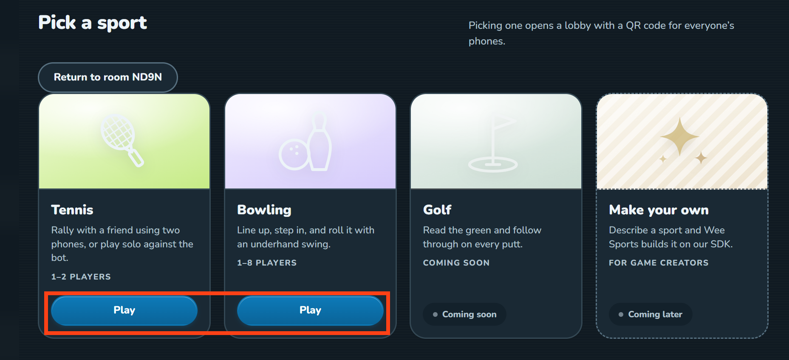
## Join from a phone with a playing name
You will see a QR code displayed on the website.
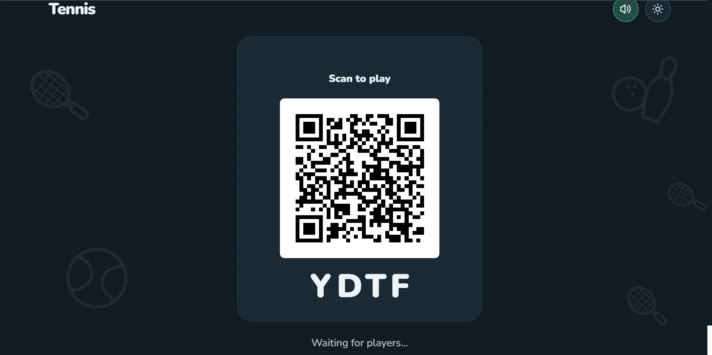
Use your phone to scan it, and you will be able to type your name and enter the game lobby.
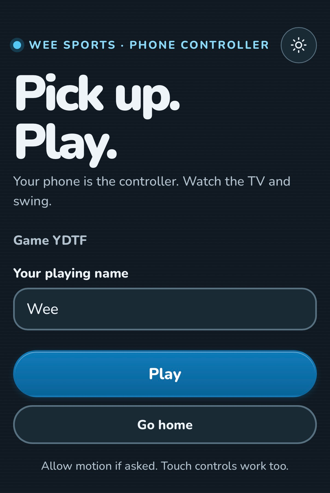

## Game lobby
This is the game lobby interface and others may join.
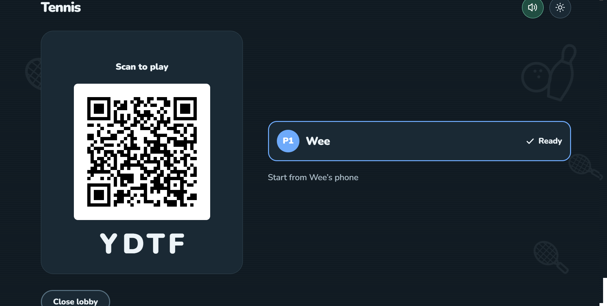
When everyone join the host may start the game on his/her phone.
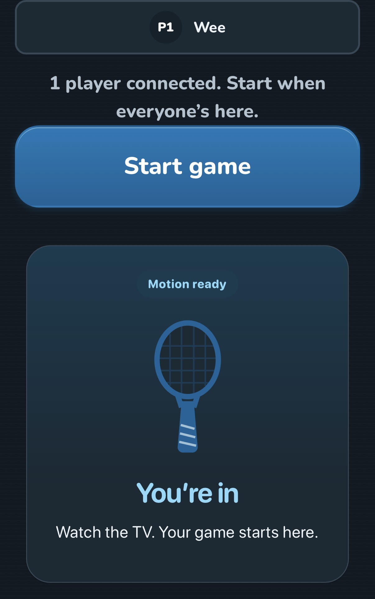

## Customise avatar
You may change the avatar of the player on your phone, and a preview is available on the screen
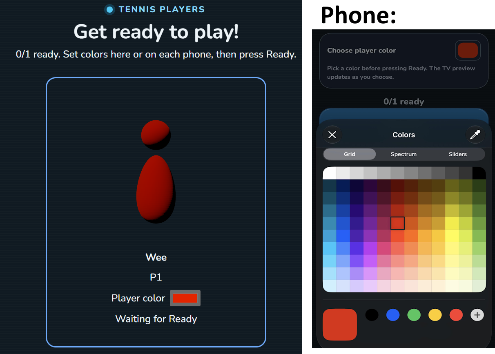

## Tutorial
All avilable games are equipped with a simple tutorial, new players may opt in for it. It will be skipped if everyone voted "no" for the tutorial. Otherwise, only the people who voted "yes" would need to do the tutorial. The following is a snapshot of tennis tutorial:
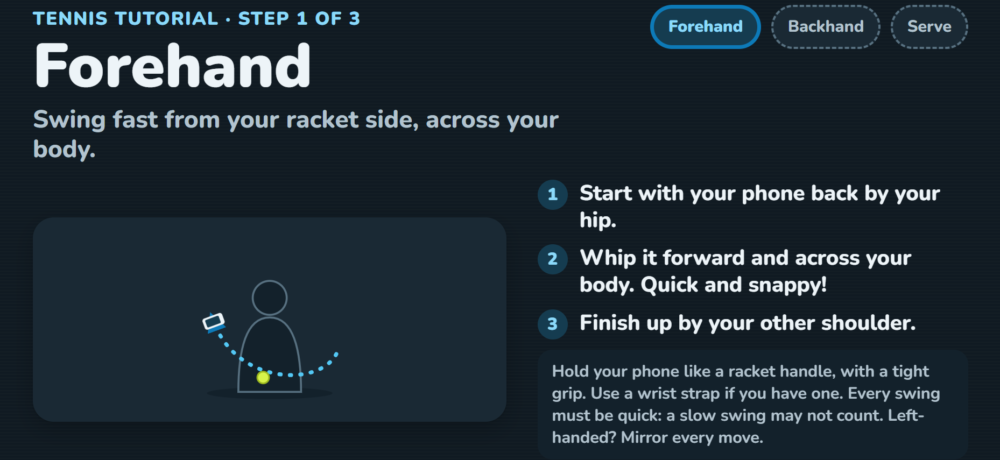
In case a player struggle to pass a tutorial, he/she may also press "skip this move" to progress.
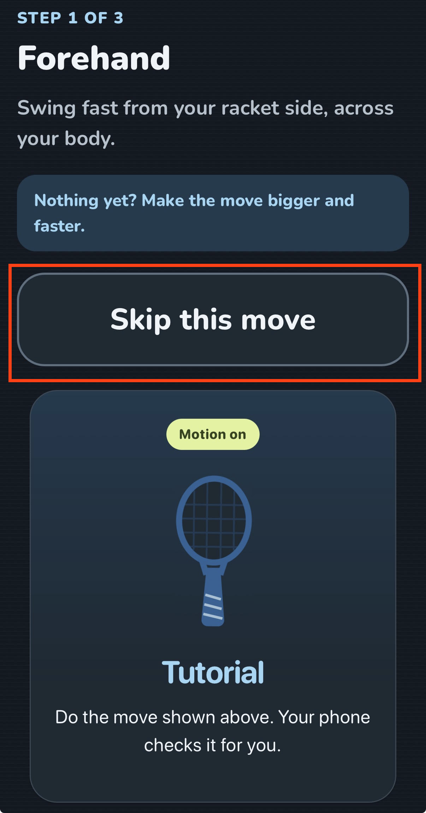

## Tennis
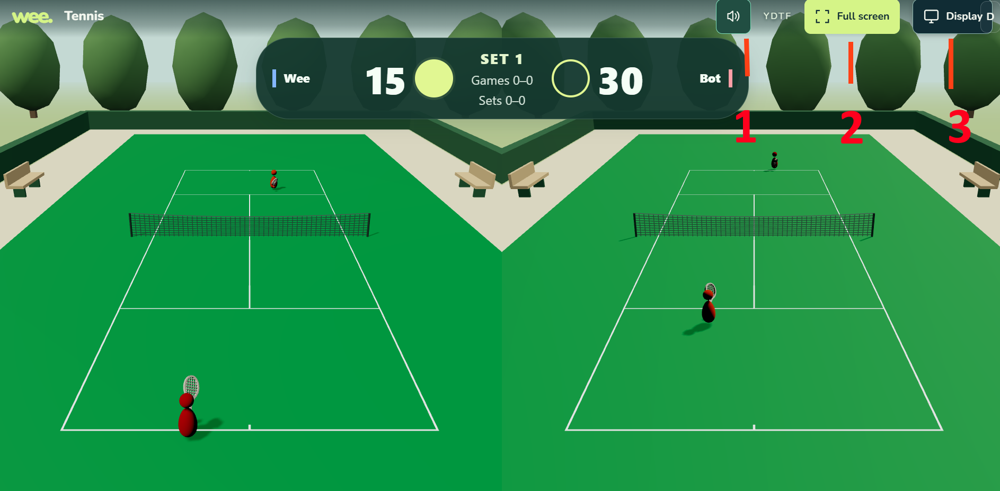
The scoreboard is shown in the tennis game. With the green colored ball indicate who is the current server. Game round and scores are displayed on the scoreboard.

Buttons:
1. Mute button for game audio.
2. Full screen
3. Options to quit or pause the game.
   
A touch control is also available for phones without motion detection, with the following UI controls.
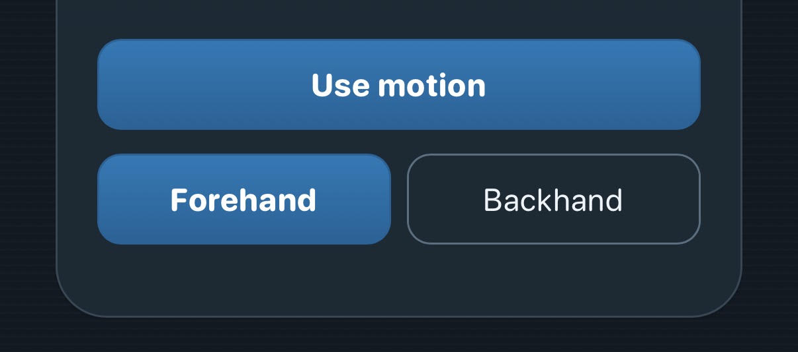

Note that the movement control in tennis is done by automatic tracking, player need not control in-game movement other than serving and hitting.

## Bowling
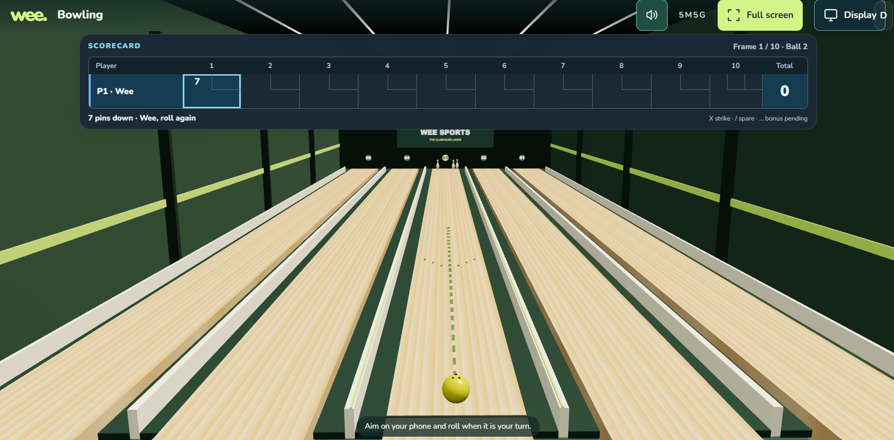
The scoreboard will show all scores of all players. The display buttons are same as tennis. (subject to change).

A dotted line is shown to assist player bowl.

A touch control is also available for phones without motion detection, with the following UI controls.
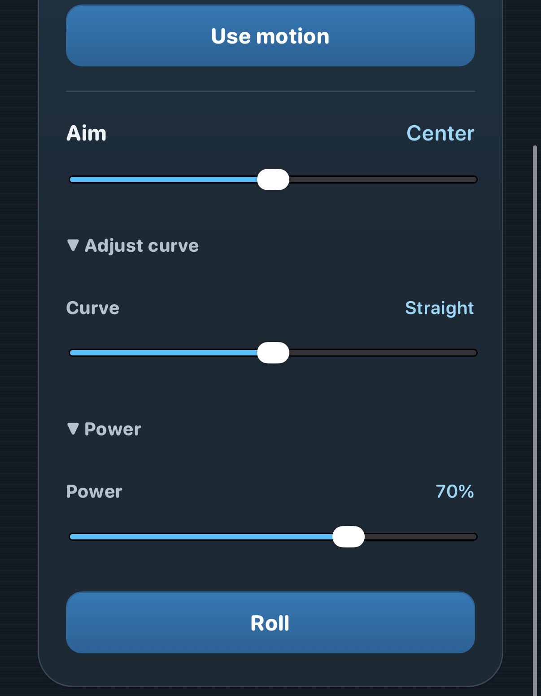

## Settings
If the user feel the motion feels strange, they may make use of settings on the phone to adjust some settings and retunr the motion calibration.

## Notes
If a player disconnects, the screen shows how long they have to reconnect.

